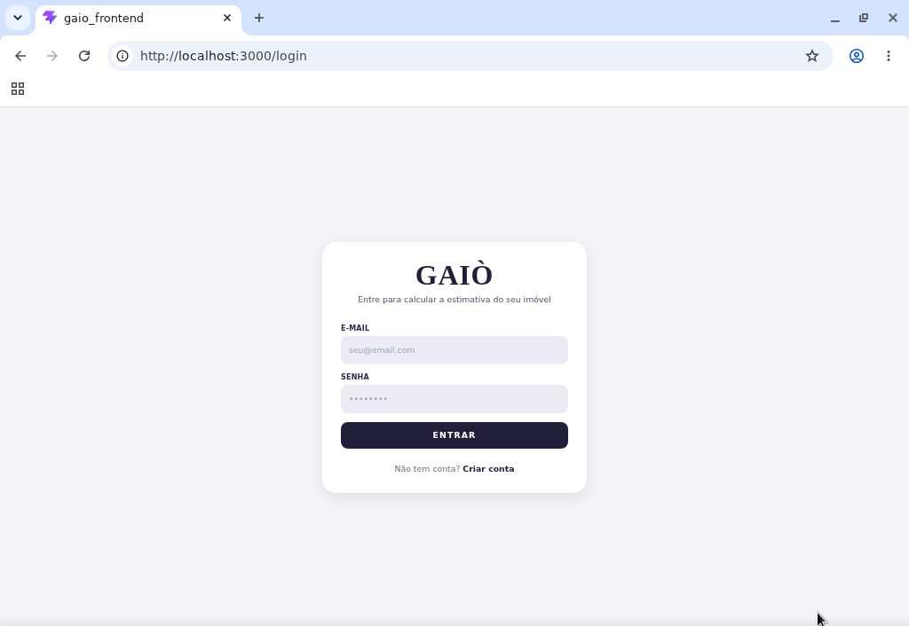
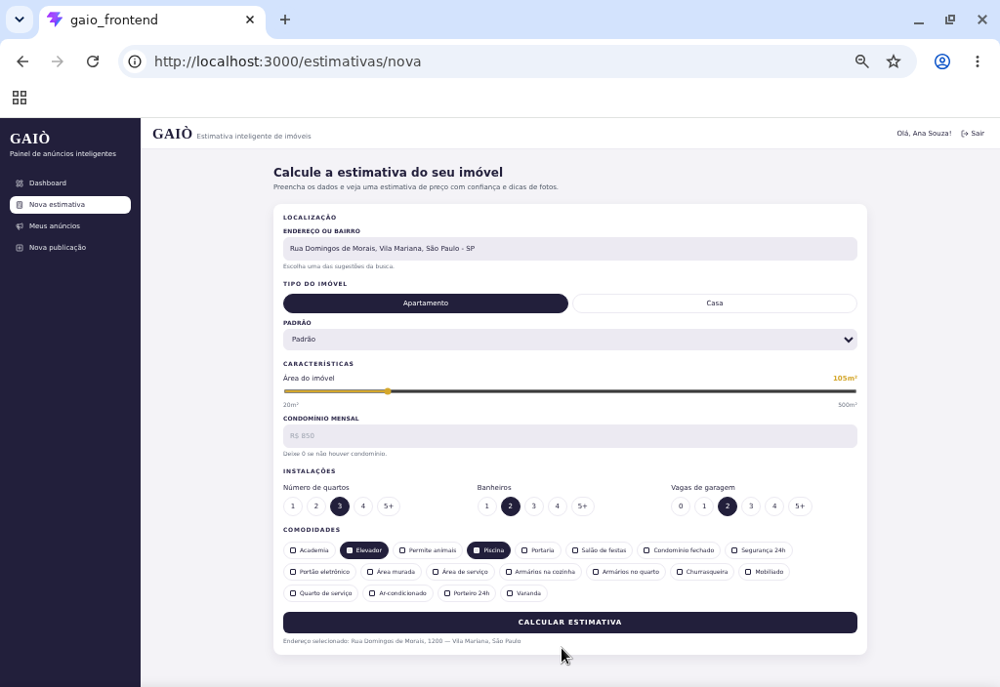
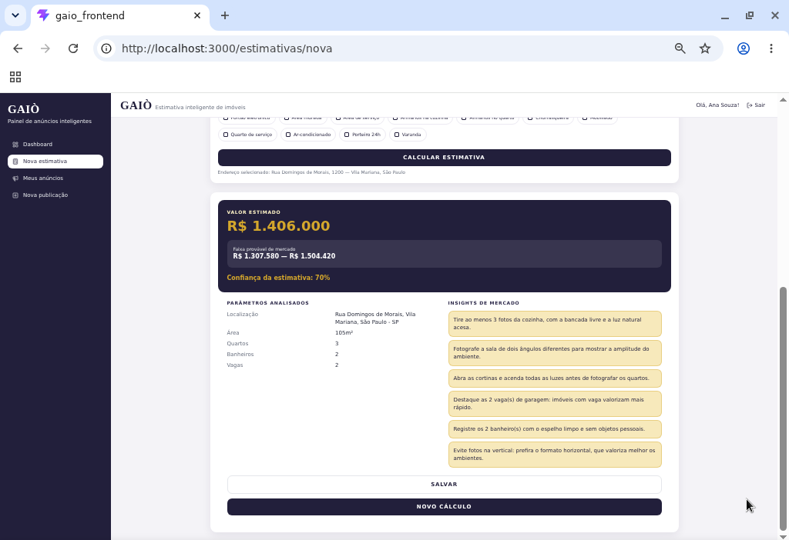

# GAIÒ Frontend

Aplicação frontend do produto **GAIÒ** para cálculo de estimativa de preço de imóveis e gestão de anúncios, construída com **React + TypeScript + Vite**.

## Telas da aplicação

### Login

Tela de acesso à aplicação, com campos de e-mail e senha e link para criação de conta.



### Nova estimativa

Formulário para informar a localização e as características do imóvel e calcular a estimativa de preço.



### Resultado da estimativa

Exibição do valor estimado, faixa provável de mercado, confiança da estimativa, parâmetros analisados e dicas para fotografar o imóvel.



## Visão geral

Este projeto implementa:

- Autenticação (login/cadastro/logout) com persistência de sessão

- Dashboard com resumo de anúncios

- Calculadora de estimativa de preço com integração API

- Autocomplete de endereço + detalhes por `placeId`

- Salvamento de estimativa autenticado

- Criação de anúncio a partir de estimativa salva

- Listagem, filtro, visualização e edição de anúncios

- Regra de publicação (`publicado=true` apenas quando `status=COMPLETO`)

- Estados de UX (loading, skeleton, empty state, toasts, disabled, confirmação)

## Stack

- React

- TypeScript

- Vite

- React Router

- Axios

- Tailwind CSS

- Lucide React (ícones)

## Requisitos

- Node.js 20+

- npm 10+

## Como instalar e rodar localmente

1. Entre na pasta do projeto:

```bash
cd /home/ubuntu/gaio_frontend
```

1. Instale dependências:

```bash
npm install
```

1. Configure variáveis de ambiente:

```bash
cp .env.example .env
```

1. Ajuste o valor da API no `.env` conforme seu backend:

```env
VITE_API_URL=http://localhost:8080
```

1. Rode em desenvolvimento:

```bash
npm run dev
```

1. Gere build de produção:

```bash
npm run build
```

## Variáveis de ambiente

| Variável       | Obrigatória | Descrição                       |
| -------------- | ----------- | ------------------------------- |
| `VITE_API_URL` | Sim         | Base URL da API do backend GAIÒ |

## Estrutura de pastas

```txt
src/
  assets/
  components/
    common/
    domain/
    layout/
  contexts/
  hooks/
  layouts/
  pages/
  routes/
  services/
  types/
  utils/
```

## Endpoints consumidos

### Autenticação

- `POST /api/auth/registrar`

- `POST /api/auth/login`

### Endereços

- `GET /api/enderecos/autocomplete?input=<texto>`

- `GET /api/enderecos/detalhes?placeId=<id>`

### Estimativas

- `POST /api/estimativas/calcular` (sem autenticação)

- `POST /api/estimativas` (com autenticação)

### Anúncios

- `POST /api/anuncios` (com autenticação)

- `GET /api/anuncios` (com filtros opcionais: `id`, `bairro`, `status`)

- `PATCH /api/anuncios/{id}` (parcial)

## Arquitetura HTTP e autenticação

- `src/services/api.ts` centraliza Axios com:
  - `baseURL` por `VITE_API_URL`

  - timeout

  - interceptor de request que injeta `Authorization: Bearer {token}`

  - interceptor de response com mensagens amigáveis para 400/401/403/404

- Em erro `401`, a sessão é limpa e o usuário é redirecionado para login via rotas protegidas.

- Nenhum token, senha ou credencial está hardcoded no código.

## Observações importantes (dados reais da API vs estado local)

1. **Resumo de anúncios no dashboard** usa **dados reais da API** (`GET /api/anuncios`).

2. **Resumo de estimativas** usa **estado local do navegador** (localStorage), pois o contrato não documenta `GET /api/estimativas`.

3. Campos visuais do protótipo sem endpoint (`Tipo do imóvel`, `Padrão`, `Condomínio mensal`, `Comodidades`) são tratados como **estado local de interface** e **não enviados** para a API.

4. O atalho **"Onde estou?"** é de navegação para busca de localização (autocomplete/detalhes), sem endpoint extra inventado.

## Acessibilidade e responsividade

- Labels associados aos inputs

- Navegação por teclado no autocomplete

- Estados de foco visíveis

- Layout responsivo com sidebar adaptável para mobile

- Cards e tabela com alternativa responsiva

## Observação de ambiente

Neste ambiente de desenvolvimento, o backend do usuário pode não estar disponível. Nesses casos:

- A aplicação frontend continua renderizando normalmente

- Chamadas HTTP podem falhar por conexão

- Estados de loading/erro são exibidos com mensagens amigáveis, sem tela branca
